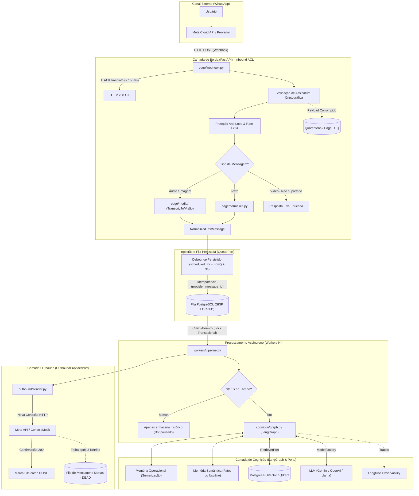

# 🚀 WhatsApp AI Harness (Production-Grade Framework)

> **Scaffolding e Arquitetura de Sustentação de Nível Corporativo para Agentes de IA no WhatsApp em Python 3.13**  
> *Baseado em Clean Architecture, Domain-Driven Design (DDD), SOLID e o padrão Ports & Adapters (Hexagonal).*

> [!NOTE]
> **Origem do Projeto:** Este projeto está sendo ativamente desenvolvido com base em meus **estudos aprofundados em engenharia de software aplicada a IA** (LangChain, LangGraph, sistemas orientados a eventos) e na identificação de **necessidades e dores reais do mercado corporativo**. O objetivo é preencher o abismo existente entre "scripts de demonstração" e sistemas verdadeiramente resilientes e prontos para produção em larga escala.

[](https://python.org)
[](https://fastapi.tiangolo.com)
[](https://langchain.com)
[](https://www.postgresql.org)
[](https://github.com/pgvector/pgvector)
[](https://langfuse.com)
[](LICENSE)

---

## 🎯 Por que este projeto existe? (O Problema Real)

Mais de **90% dos agentes de WhatsApp falham quando saem do ambiente de demonstração** e vão para produção. Os motivos mais comuns enfrentados pelas empresas são:

1. **Gargalo no Webhook (Timeout & Loops de Cobrança):** A Meta exige confirmação HTTP (`HTTP 200 OK`) em menos de 2 a 3 segundos. Se a chamada da LLM demorar 10 segundos na mesma requisição do webhook, a Meta reenvia a mensagem repetidamente, criando loops infinitos e faturas astronômicas de tokens.
2. **Rajadas de Mensagens do Usuário (Falta de Debounce):** No WhatsApp, os usuários não escrevem parágrafos únicos; eles mandam *"Oi"*, *"Tudo bem?"*, *"Quero saber o preço do plano"* em 3 mensagens em sequência. Sem debounce, o bot dispara 3 execuções paralelas e desordenadas do agente para o mesmo cliente.
3. **Explosão de Contexto e Custo:** No WhatsApp não existe o botão "Novo Chat". A conversa dura semanas ou meses. Sem compactação de contexto e memória semântica segregada, o histórico satura a janela de contexto da LLM e estoura o orçamento de tokens.
4. **Acoplamento Extremo (Vendor Lock-in):** Projetos que misturam SDKs da Meta, bibliotecas de LLM e acesso a banco de dados no mesmo script tornam qualquer troca de modelo ou canal quase impossível.

---

## 💡 A Solução: O Conceito de "Harness"

Em sistemas de inteligência artificial de alta escala, **o modelo (LLM) é tratado como uma commodity intercambiável**. A verdadeira inteligência de engenharia está na **Harness**: todo o scaffolding que protege, recebe, valida, enfileira, controla o contexto, aplica retries e audita o ciclo de vida da mensagem.

Este projeto implementa uma **Harness de Produção** inspirada na palestra e modelo arquitetural de engenharia de software para agentes no WhatsApp, projetada com o rigor de engenharia de software corporativo (DDD, SOLID, Ports & Adapters) adaptado para o ecossistema moderno do **Python 3.13**.

---

## 🏗️ Visão da Arquitetura e Fluxo Ponta a Ponta



---

## 🌟 Principais Destaques de Engenharia

### 1. Separação Estrita de Processos (Borda Leve vs. Worker Pesado)
* **Borda (`edge/`)**: Servidor HTTP assíncrono enxuto, focado exclusivamente em dar ACK instantâneo (`< 150ms`), autenticar payloads, normalizar formatos e enfileirar.
* **Worker (`workers/`)**: Processo de segundo plano desacoplado que consome a fila com concorrência segura e horizontal (`SELECT ... FOR UPDATE SKIP LOCKED`).
* **Admin/Ops (`ops/`)**: API administrativa para telemetria, inspeção de conversas e reprocessamento de mensagens da DLQ.

### 2. A Fila só trafega Texto (`NormalizedTextMessage`)
* A mídia (áudio e imagem) é resolvida **na borda** (`edge/media/`), sendo transcrita/descrita em texto antes de entrar na fila.
* Isso garante que a camada de cognição seja puramente textual, reduzindo custos de tokens, simplificando os testes unitários e tornando o modelo de IA facilmente intercambiável.

### 3. Debounce e Idempotência Persistidos no Banco
* O debounce **não ocorre na memória frágil do processo web**. Ele é controlado diretamente no PostgreSQL através do campo `scheduled_for`: se o usuário mandar 3 mensagens em 2 segundos, o banco concatena o texto e empurra o agendamento para frente. O worker só captura itens quando `scheduled_for <= now()`.
* Deduplicação nativa através de constraint `UNIQUE (provider_message_id)`.

### 4. Padrão Ports & Adapters (100% Agnóstico)
Todas as integrações externas são contratos estritos baseados em `typing.Protocol` (o equivalente às `interfaces` do C#/.NET), permitindo trocar de ferramenta sem alterar o código do domínio:
* **Fila (`QueuePort`)**: PostgreSQL no MVP $\rightarrow$ RabbitMQ, Redis ou AWS SQS no futuro.
* **Provedor de LLM (`ModelFactory`)**: Google Gemini $\leftrightarrow$ OpenAI $\leftrightarrow$ Llama (Ollama/Groq local).
* **RAG / Vector Store (`RetrieverPort`)**: PostgreSQL (`pgvector`) no MVP $\leftrightarrow$ Qdrant, Chroma ou Pinecone.
* **Outbound (`OutboundProviderPort`)**: `ConsoleMock` (para testes locais sem gastar tokens) $\leftrightarrow$ Meta Cloud API / Evolution API / Z-API.

### 5. Resiliência em Camadas (Dual DLQ)
* **Quarentena de Borda (Edge DLQ)**: Armazena requisições malformadas, assinaturas inválidas ou falhas de download sem interromper a API nem derrubar o webhook.
* **Dead-Letter Queue de Negócio (Business DLQ)**: Se a LLM ou a API do provedor falharem após 3 tentativas com backoff exponencial, a mensagem é preservada com status `dead` com stacktrace completo para reprocessamento manual via API Admin.

### 6. Dupla Memória e Transbordo Humano (Handoff)
* **Memória Operacional**: Histórico recente com compactação/sumarização automática via LangGraph.
* **Memória Semântica**: Fatos persistentes aprendidos sobre o cliente (ex.: *"gosta de reuniões pela manhã"*, *"empresa: XPTO"*).
* **Handoff**: Capacidade de alternar o status da thread para `human`, pausando o agente de IA enquanto um atendente opera a conversa pelo painel.

---

## 🛠️ Stack Tecnológica

| Componente | Tecnologia | Rationale de Engenharia |
| :--- | :--- | :--- |
| **Linguagem** | Python 3.13+ | Tipagem estática avançada, melhorias de performance e modernidade sintática. |
| **Gerenciador de Pacotes** | `uv` (Astral) | Resolução de dependências ultrarrápida em Rust, lockfiles determinísticos. |
| **Web & Ingestão** | FastAPI + Uvicorn | Baixa latência, validação nativa com Pydantic v2 e conformidade OpenAPI. |
| **Contratos & Configuração**| Pydantic v2 + Pydantic Settings | Tipagem estrita, serialização rápida e hierarquia `harness.yaml` + `.env`. |
| **Fila & Banco de Dados** | PostgreSQL 16+ com `pgvector` | Fila transacional concorrente (`SKIP LOCKED`), armazenamento de threads e busca vetorial unificados. |
| **Driver de Banco** | `psycopg` v3 (async + pool) | Conexões assíncronas nativas de alta performance em Python. |
| **Cognição & Agente** | LangChain v1 / LangGraph | Orquestração de grafos de estados cíclicos, ferramentas e sumarização. |
| **Observabilidade** | Langfuse + OpenTelemetry | Rastreamento ponta a ponta de latência, nós de agentes, tokens e custos por execução. |
| **Testes & Qualidade** | Pytest, Pytest-Asyncio, Ruff | TDD, testes assíncronos e linting/formatação estritos no padrão Clean Code. |

---

## 📂 Estrutura de Pastas do Projeto

```text
whatsapp_harness/
├── .specify/                        # Especificações formais do SpecKit (Constitution, Templates)
├── specs/                           # Documentos de Requisitos e Critérios de Aceite (Spec-Driven Development)
│   └── 001-whatsapp-harness-mvp/
│       ├── spec.md                  # Especificação oficial da feature (User Stories P1 a P4)
│       └── checklists/              # Checklist de qualidade dos requisitos
├── configs/
│   └── harness.yaml                 # Configurações operacionais (debounce ms, retries, flags de mídia)
├── docker-compose.yml               # PostgreSQL 16 com extensão pgvector
├── pyproject.toml                   # Dependências e metadados gerenciados pelo uv
├── .env.example                     # Modelo de variáveis de ambiente
│
├── src/harness/
│   ├── domain/                      # NÚCLEO PURO (Zero dependências externas)
│   │   ├── message.py               # Value Objects: InboundMessage, NormalizedTextMessage
│   │   ├── thread.py                # Entidade Thread, ThreadId, Status (bot | human)
│   │   ├── queue.py                 # Entidade QueueItem, Status (pending | processing | done | dead)
│   │   ├── ports.py                 # Interfaces / Protocols (QueuePort, OutboundPort, RetrieverPort)
│   │   └── events.py                # Domain Events para auditoria
│   │
│   ├── edge/                        # BORDA HTTP (FastAPI - ACK imediato e normalização)
│   │   ├── webhook.py               # Endpoint POST /webhook com ACK < 150ms
│   │   ├── verify.py                # Validação de assinatura criptográfica (X-Hub-Signature-256)
│   │   ├── rate_limit.py            # Proteção anti-loop de agentes
│   │   ├── normalize.py             # Limpeza e sanitização de payloads
│   │   ├── resilience.py            # Fast-retry de ingestão com tenacity + quarentena (Edge DLQ)
│   │   └── media/                   # Conversão de áudio/imagem em texto antes da fila
│   │
│   ├── ingress/                     # ADAPTADORES DE FILA (Implementação da QueuePort)
│   │   └── postgres_queue.py        # Fila relacional com SKIP LOCKED e debounce via scheduled_for
│   │
│   ├── workers/                     # CONSUMO ASSÍNCRONO
│   │   ├── runner.py                # Loop contínuo de polling e consumo da fila
│   │   ├── claim.py                 # Lock atômico concorrente
│   │   └── pipeline.py              # Orquestrador: Fila -> Cognição -> Outbound -> ACK
│   │
│   ├── cognition/                   # INTELIGÊNCIA ARTIFICIAL (LangGraph)
│   │   ├── graph.py                 # Compilação do grafo de agente
│   │   ├── factory.py               # ModelFactory (Gemini, OpenAI, Llama/Ollama)
│   │   ├── context.py               # Middleware de auto-sumarização para contexto longo
│   │   ├── semantic_memory.py       # Extração e consulta de fatos do cliente
│   │   └── retrievers/              # VectorStoreFactory (PGVector / Qdrant)
│   │
│   ├── outbound/                    # ENVIO DE MENSAGENS (Outbound ACL)
│   │   ├── sender.py                # Despachante de envio com retries
│   │   └── providers/               # Adaptadores: MetaProvider, ConsoleMock
│   │
│   ├── ops/                         # OPERAÇÕES E OBSERVABILIDADE
│   │   ├── admin_api.py             # Endpoints para inspecionar fila e reprocessar mensagens mortas
│   │   ├── telemetry.py             # Instrumentação OpenTelemetry e Langfuse
│   │   └── security.py              # Autenticação de rotas administrativas
│   │
│   └── app.py                       # Composição de dependências (Wiring)
│
├── scripts/
│   ├── send_fake_msg.py             # Simulador CLI de webhooks (envia rajadas e áudios de teste)
│   └── seed_knowledge.py           # Script para indexar documentos e FAQs no banco vetorial
│
└── tests/                           # SUÍTE DE TESTES (TDD)
    ├── unit/                        # Testes de regras de domínio, normalização e contratos
    ├── integration/                 # Testes de concorrência de fila e idempotência no Postgres
    └── load/                        # Testes de estresse e simulação de concorrência
```

---

## 🚦 Metodologia de Desenvolvimento: Spec-Driven Development (SpecKit)

Este projeto foi construído utilizando a metodologia **Spec-Driven Development (SDD)** através do framework **SpecKit**, garantindo rastreabilidade entre requisitos de negócio e implementação:

1. **[Constitution](.specify/memory/constitution.md)**: As leis imutáveis do projeto (DDD, SOLID, Clean Code, KISS, YAGNI e as 8 regras sagradas do isolamento de processos).
2. **[Specification (spec.md)](specs/001-whatsapp-harness-mvp/spec.md)**: Histórias de usuário priorizadas (P1 a P4), cenários de aceite em formato *Given/When/Then* e requisitos funcionais auditáveis.
3. **Plan (plan.md)**: Plano arquitetural detalhado, modelagem de dados e diagramas técnicos.
4. **Tasks (tasks.md)**: Checklist atômico de tarefas de desenvolvimento guiadas por testes.

---

## ⚡ Como Rodar o Projeto Localmente

### Pré-requisitos
* Python 3.13+ instalado
* [uv](https://github.com/astral-sh/uv) instalado (`pip install uv` ou via instalador oficial)
* Docker e Docker Compose instalados

### 1. Clonar e Instalar Dependências
```bash
git clone https://github.com/seu-usuario/harness-whatsapp.git
cd harness-whatsapp

# Sincroniza o ambiente virtual automaticamente com uv
uv sync
```

### 2. Subir o Banco de Dados (PostgreSQL + pgvector)
```bash
docker compose up -d
```

### 3. Configurar Variáveis de Ambiente
```bash
cp .env.example .env
# Configure suas chaves ou use as opções de Mock local
```

### 4. Executar os Processos

Em terminais separados (ou orquestrado via scripts):

```bash
# Terminal 1: Iniciar a Borda HTTP (Webhook)
uv run python -m harness.edge.webhook

# Terminal 2: Iniciar o Worker Assíncrono
uv run python -m harness.workers.runner
```

### 5. Simular Mensagens com o CLI (A Custo Zero)
Dispare mensagens sintéticas para testar o debounce, a idempotência e o agente `Echo` impresso no console:

```bash
# Disparar uma mensagem de teste
uv run python scripts/send_fake_msg.py --text "Olá, gostaria de saber os horários de atendimento"

# Disparar uma rajada rápida (testando o debounce no PostgreSQL)
uv run python scripts/send_fake_msg.py --burst 3 --phone "5511999998888"
```

---

## 👨‍💻 Autor e Motivação

Este projeto é idealizado e desenvolvido ativamente por **Paulo Pitte**.

Nasce da convergência entre uma sólida bagagem em arquitetura de software corporativa (Clean Architecture, DDD, ecossistema fortemente tipado) e **estudos aprofundados contínuos no ecossistema moderno de IA em Python** (LangChain v1, LangGraph, bancos vetoriais e observabilidade). 

O projeto serve como um **Case de Engenharia Prática e Estudo Aplicado**, demonstrando como solucionar as dores e gargalos reais enfrentados pelo mercado ao implantar agentes autônomos em canais de alto volume como o WhatsApp.

* **LinkedIn:** [linkedin.com/in/paulopitte](https://linkedin.com/in/paulopitte)
* **GitHub:** [github.com/paulopitte](https://github.com/paulopitte)

---
*Projeto sob licença MIT. Feito com rigor de engenharia de software.*
