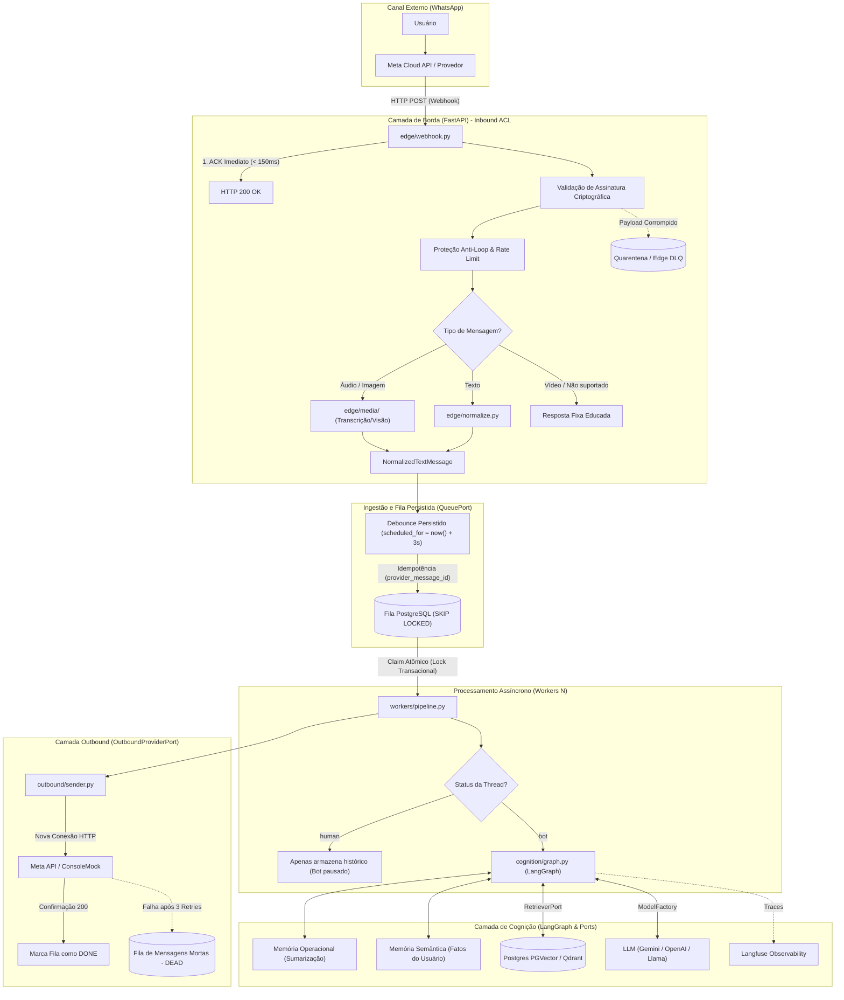

# 🚀 Arquitetura de uma Harness para Agentes de WhatsApp

> **Arquitetura de uma Harness para Agentes de WhatsApp de Nível Corporativo em Python 3.13**  
> *Baseado em Clean Architecture, Domain-Driven Design (DDD), SOLID e o padrão Ports & Adapters (Hexagonal).*

> [!NOTE]
> **Origem do Projeto:** Este projeto está sendo ativamente desenvolvido com base em meus **estudos aprofundados em engenharia de software aplicada a IA** (LangChain, LangGraph, sistemas orientados a eventos) e na identificação de **necessidades e dores reais do mercado corporativo**. O objetivo é preencher o abismo existente entre "scripts de demonstração" e sistemas verdadeiramente resilientes e prontos para produção em larga escala.

[](https://python.org)
[](https://fastapi.tiangolo.com)
[](https://langchain.com)
[](https://www.postgresql.org)
[](https://github.com/pgvector/pgvector)
[](https://langfuse.com)
[](LICENSE)

---

## 🎯 Por que este projeto existe? (O Problema Real)

Mais de **90% dos agentes de WhatsApp falham quando saem do ambiente de demonstração** e vão para produção. Os motivos mais comuns enfrentados pelas empresas são:

1. **Gargalo no Webhook (Timeout & Loops de Cobrança):** A Meta exige confirmação HTTP (`HTTP 200 OK`) em menos de 2 a 3 segundos. Se a chamada da LLM demorar 10 segundos na mesma requisição do webhook, a Meta reenvia a mensagem repetidamente, criando loops infinitos e faturas astronômicas de tokens.
2. **Rajadas de Mensagens do Usuário (Falta de Debounce):** No WhatsApp, os usuários não escrevem parágrafos únicos; eles mandam *"Oi"*, *"Tudo bem?"*, *"Quero saber o preço do plano"* em 3 mensagens em sequência. Sem debounce, o bot dispara 3 execuções paralelas e desordenadas do agente para o mesmo cliente.
3. **Explosão de Contexto e Custo:** No WhatsApp não existe o botão "Novo Chat". A conversa dura semanas ou meses. Sem compactação de contexto e memória semântica segregada, o histórico satura a janela de contexto da LLM e estoura o orçamento de tokens.
4. **Acoplamento Extremo (Vendor Lock-in):** Projetos que misturam SDKs da Meta, bibliotecas de LLM e acesso a banco de dados no mesmo script tornam qualquer troca de modelo ou canal quase impossível.

---

## 💡 A Solução: O Conceito de "Harness" e Fundamentação Teórica

Em sistemas de inteligência artificial de alta escala, **o modelo (LLM) não é o produto — ele é uma commodity intercambiável**. Conforme sistematizado no paper [Externalization in LLM Agents: A Unified Review of Memory, Skills, Protocols and Harness Engineering (arXiv:2604.08224)](https://arxiv.org/abs/2604.08224) e nos estudos de arquitetura de produção para agentes conversacionais, agentes úteis deixam de depender apenas do comportamento interno do modelo e passam a **externalizar** capacidades críticas em quatro pilares:
1. **Memória (`Memory`)**: Separação explícita entre continuidade operacional da conversa atual e fatos duráveis sobre o usuário.
2. **Habilidades (`Skills` / `Tools`)**: Ferramentas determinísticas e busca vetorial RAG desacopladas do prompt.
3. **Protocolos (`Protocols`)**: Contratos formais e interfaces estritas (`typing.Protocol`) nas fronteiras de entrada, fila, cognição e saída.
4. **Harness (`Coordenação Operacional`)**: A camada de arquitetura que governa como o agente recebe contexto, mantém continuidade, respeita limites de custo/segurança, registra auditoria e evolui sem quebrar o sistema inteiro.

### 📈 A Escada de Maturidade em Engenharia de Agentes

| Degrau | Nível de Maturidade | Características | Limitação em Produção no WhatsApp |
| :--- | :--- | :--- | :--- |
| **1. Chamada de API** | *Prompt in, Text out* | Chamada direta ao SDK da LLM sem estado. | Sem memória, sem ferramentas e sem resiliência. |
| **2. App com Agente** | *Wrapper + Tool Use* | Rota HTTP que instancia um agente e aguarda resposta na mesma requisição. | Sofre timeouts na Meta (`> 3s`), duplicação de envios e perda silenciosa sob pressão. |
| **3. Runtime** | *Orquestração de Grafo* | Uso de `StateGraph` (LangGraph), checkpoints e persistência de sessão. | Resolve a execução do grafo, mas não resolve a mensageria real (rajadas, mídia, DLQ, handoff). |
| **4. Harness (Este Projeto)** | **Sistema Operável Completo** | **Borda ACL + Fila Transacional (`SKIP LOCKED`) + Debounce Persistido + Dupla Memória + Guardrails + Observabilidade + Admin API.** | **Arquitetura pronta para operação corporativa real.** |

---

## 🏗️ Visão da Arquitetura e Fluxo Ponta a Ponta



---

## 🌟 Principais Destaques de Engenharia

### 1. Separação Estrita de Processos (Borda Leve vs. Worker Pesado)
* **Borda (`edge/`)**: Servidor HTTP assíncrono enxuto, focado exclusivamente em dar ACK instantâneo (`< 150ms`), autenticar payloads, normalizar formatos e enfileirar.
* **Worker (`workers/`)**: Processo de segundo plano desacoplado que consome a fila com concorrência segura e horizontal (`SELECT ... FOR UPDATE SKIP LOCKED`).
* **Admin/Ops (`ops/`)**: API administrativa para telemetria, inspeção de conversas e reprocessamento de mensagens da DLQ.

### 2. A Fila só trafega Texto (`NormalizedTextMessage`)
* A mídia (áudio e imagem) é resolvida **na borda** (`edge/media/`), sendo transcrita/descrita em texto antes de entrar na fila.
* Isso garante que a camada de cognição seja puramente textual, reduzindo custos de tokens, simplificando os testes unitários e tornando o modelo de IA facilmente intercambiável.

### 3. Debounce e Idempotência Persistidos no Banco
* O debounce **não ocorre na memória frágil do processo web**. Ele é controlado diretamente no PostgreSQL através do campo `scheduled_for`: se o usuário mandar 3 mensagens em 2 segundos, o banco concatena o texto e empurra o agendamento para frente. O worker só captura itens quando `scheduled_for <= now()`.
* Deduplicação nativa através de constraint `UNIQUE (provider_message_id)`.

### 4. Padrão Ports & Adapters (100% Agnóstico)
Todas as integrações externas são contratos estritos baseados em `typing.Protocol` (o equivalente às `interfaces` do C#/.NET), permitindo trocar de ferramenta sem alterar o código do domínio:
* **Fila (`QueuePort`)**: PostgreSQL no MVP $\rightarrow$ RabbitMQ, Redis ou AWS SQS no futuro.
* **Provedor de LLM (`ModelFactory`)**: Google Gemini $\leftrightarrow$ OpenAI $\leftrightarrow$ Llama (Ollama/Groq local).
* **RAG / Vector Store (`RetrieverPort`)**: PostgreSQL (`pgvector`) no MVP $\leftrightarrow$ Qdrant, Chroma ou Pinecone.
* **Outbound (`OutboundProviderPort`)**: `ConsoleMock` (para testes locais sem gastar tokens) $\leftrightarrow$ Meta Cloud API / Evolution API / Z-API.

### 5. Resiliência em Camadas (Dual DLQ)
* **Quarentena de Borda (Edge DLQ)**: Armazena requisições malformadas, assinaturas inválidas ou falhas de download sem interromper a API nem derrubar o webhook.
* **Dead-Letter Queue de Negócio (Business DLQ)**: Se a LLM ou a API do provedor falharem após 3 tentativas com backoff exponencial, a mensagem é preservada com status `dead` com stacktrace completo para reprocessamento manual via API Admin.

### 6. Dupla Memória e Transbordo Humano (Handoff)
* **Memória Operacional**: Histórico recente com compactação/sumarização automática via LangGraph.
* **Memória Semântica**: Fatos persistentes aprendidos sobre o cliente (ex.: *"gosta de reuniões pela manhã"*, *"empresa: XPTO"*).
* **Handoff**: Capacidade de alternar o status da thread para `human`, pausando o agente de IA enquanto um atendente opera a conversa pelo painel.

### 7. Guardrails em Duas Camadas & Pipeline de Middlewares (LangGraph)
* **Guardrails Ativos**: Proteção na borda (sanitização de PII e caracteres inválidos) e nós de *Input/Output Guardrails* no LangGraph, bloqueando ataques de *Prompt Injection* e desvios de escopo antes de gastar tokens na LLM principal.
* **Middlewares Extensíveis (Estilo MediatR Pipeline)**: Interceptação assíncrona de ciclo de vida no LangGraph para auditoria de latência, controle de teto de custos/tokens por usuário e logs estruturados de auditoria.

### 8. Prompt Management & Versionamento Dinâmico (PromptOps)
* **Controle de Versões em Produção**: Gerenciamento de prompts desacoplado via Langfuse Prompt Management com tags/labels (`production`, `staging`, `canary`) e histórico imutável.
* **Zero-Downtime Rollback & Fallback Local**: Capacidade de atualizar ou reverter a versão do prompt do agente em tempo real sem redeploy de código nem reinício de containers, com cache em memória (TTL) e fallback automático para arquivos locais versionados em `configs/prompts/*.yaml`.

---

## 🛠️ Stack Tecnológica

| Componente | Tecnologia | Rationale de Engenharia |
| :--- | :--- | :--- |
| **Linguagem** | Python 3.13+ | Tipagem estática avançada, melhorias de performance e modernidade sintática. |
| **Gerenciador de Pacotes** | `uv` (Astral) | Resolução de dependências ultrarrápida em Rust, lockfiles determinísticos. |
| **Web & Ingestão** | FastAPI + Uvicorn | Baixa latência, validação nativa com Pydantic v2 e conformidade OpenAPI. |
| **Contratos & Configuração**| Pydantic v2 + Pydantic Settings | Tipagem estrita, serialização rápida e hierarquia `harness.yaml` + `.env`. |
| **Fila & Banco de Dados** | PostgreSQL 16+ com `pgvector` | Fila transacional concorrente (`SKIP LOCKED`), armazenamento de threads e busca vetorial unificados. |
| **Driver de Banco** | `psycopg` v3 (async + pool) | Conexões assíncronas nativas de alta performance em Python. |
| **Cognição & Agente** | LangChain v1 / LangGraph | Orquestração de grafos de estados cíclicos, ferramentas e sumarização. |
| **PromptOps & Tracing** | Langfuse | Rastreamento ponta a ponta de latência, tokens, custos e versionamento dinâmico de prompts. |
| **Observabilidade de Sistema** | OpenTelemetry | Telemetria e logs estruturados padronizados para ferramentas como Datadog/Grafana. |
| **Testes & Qualidade** | Pytest, Pytest-Asyncio, Ruff | TDD, testes assíncronos e linting/formatação estritos no padrão Clean Code. |

---

## 📂 Estrutura de Pastas do Projeto

```text
whatsapp_harness/
├── .specify/                        # Especificações formais do SpecKit (Constitution, Templates)
├── specs/                           # Documentos de Requisitos e Critérios de Aceite (Spec-Driven Development)
│   └── 001-whatsapp-harness-mvp/
│       ├── spec.md                  # Especificação oficial da feature (User Stories P1 a P4)
│       └── checklists/              # Checklist de qualidade dos requisitos
├── configs/
│   ├── harness.yaml                 # Configurações operacionais (debounce ms, retries, flags de mídia)
│   └── prompts/                     # Prompts locais para desenvolvimento offline e fallback (PromptPort)
│       └── default_agent.yaml
├── docker-compose.yml               # PostgreSQL 16 com extensão pgvector
├── pyproject.toml                   # Dependências e metadados gerenciados pelo uv
├── .env.example                     # Modelo de variáveis de ambiente
│
├── src/harness/
│   ├── domain/                      # NÚCLEO PURO (Zero dependências externas)
│   │   ├── message.py               # Value Objects: InboundMessage, NormalizedTextMessage
│   │   ├── thread.py                # Entidade Thread, ThreadId, Status (bot | human)
│   │   ├── queue.py                 # Entidade QueueItem, Status (pending | processing | done | dead)
│   │   ├── ports.py                 # Interfaces / Protocols (QueuePort, OutboundPort, RetrieverPort)
│   │   └── events.py                # Domain Events para auditoria
│   │
│   ├── edge/                        # BORDA HTTP (FastAPI - ACK imediato e normalização)
│   │   ├── webhook.py               # Endpoint POST /webhook com ACK < 150ms
│   │   ├── verify.py                # Validação de assinatura criptográfica (X-Hub-Signature-256)
│   │   ├── rate_limit.py            # Proteção anti-loop de agentes
│   │   ├── normalize.py             # Limpeza e sanitização de payloads
│   │   ├── resilience.py            # Fast-retry de ingestão com tenacity + quarentena (Edge DLQ)
│   │   └── media/                   # Conversão de áudio/imagem em texto antes da fila
│   │
│   ├── ingress/                     # ADAPTADORES DE FILA (Implementação da QueuePort)
│   │   └── postgres_queue.py        # Fila relacional com SKIP LOCKED e debounce via scheduled_for
│   │
│   ├── workers/                     # CONSUMO ASSÍNCRONO
│   │   ├── runner.py                # Loop contínuo de polling e consumo da fila
│   │   ├── claim.py                 # Lock atômico concorrente
│   │   └── pipeline.py              # Orquestrador: Fila -> Cognição -> Outbound -> ACK
│   │
│   ├── cognition/                   # INTELIGÊNCIA ARTIFICIAL (LangGraph)
│   │   ├── graph.py                 # Compilação do grafo de agente
│   │   ├── factory.py               # ModelFactory (Gemini, OpenAI, Llama/Ollama)
│   │   ├── context.py               # Middleware de auto-sumarização para contexto longo
│   │   ├── semantic_memory.py       # Extração e consulta de fatos do cliente
│   │   └── retrievers/              # VectorStoreFactory (PGVector / Qdrant)
│   │
│   ├── outbound/                    # ENVIO DE MENSAGENS (Outbound ACL)
│   │   ├── sender.py                # Despachante de envio com retries
│   │   └── providers/               # Adaptadores: MetaProvider, ConsoleMock
│   │
│   ├── ops/                         # OPERAÇÕES E OBSERVABILIDADE
│   │   ├── admin_api.py             # Endpoints para inspecionar fila e reprocessar mensagens mortas
│   │   ├── telemetry.py             # Instrumentação OpenTelemetry e Langfuse
│   │   └── security.py              # Autenticação de rotas administrativas
│   │
│   └── app.py                       # Composição de dependências (Wiring)
│
├── scripts/
│   ├── send_fake_msg.py             # Simulador CLI de webhooks (envia rajadas e áudios de teste)
│   └── seed_knowledge.py           # Script para indexar documentos e FAQs no banco vetorial
│
└── tests/                           # SUÍTE DE TESTES (TDD)
    ├── unit/                        # Testes de regras de domínio, normalização e contratos
    ├── integration/                 # Testes de concorrência de fila e idempotência no Postgres
    └── load/                        # Testes de estresse e simulação de concorrência
```

---

## 🚦 Metodologia de Desenvolvimento: Spec-Driven Development (SpecKit)

Este projeto foi construído utilizando a metodologia **Spec-Driven Development (SDD)** através do framework **SpecKit**, garantindo rastreabilidade entre requisitos de negócio e implementação:

1. **[Constitution](.specify/memory/constitution.md)**: As leis imutáveis do projeto (DDD, SOLID, Clean Code, KISS, YAGNI e as 8 regras sagradas do isolamento de processos).
2. **[Specification (spec.md)](specs/001-whatsapp-harness-mvp/spec.md)**: Histórias de usuário priorizadas (P1 a P4), cenários de aceite em formato *Given/When/Then* e requisitos funcionais auditáveis.
3. **Plan (plan.md)**: Plano arquitetural detalhado, modelagem de dados e diagramas técnicos.
4. **Tasks (tasks.md)**: Checklist atômico de tarefas de desenvolvimento guiadas por testes.

---

## ⚡ Guia Passo a Passo: Como Subir e Testar o Projeto Localmente

> [!TIP]
> **Para Novos Desenvolvedores:** Você **não precisa ter conta na Meta/WhatsApp Business** nem pagar por chaves de API para rodar e testar 100% da arquitetura! O projeto já vem configurado para usar **Ollama local** e **ConsoleMock** no outbound por padrão.

### Pré-requisitos
* **Python 3.13+** instalado
* **[uv](https://github.com/astral-sh/uv)** instalado (`pip install uv` ou via instalador oficial)
* **PostgreSQL 16+** (via Docker Compose `docker compose up -d` ou instalação nativa no Windows/Linux)
* *(Opcional)* **[Ollama](https://ollama.com/)** instalado localmente para rodar o modelo `llama3.2` sem custo

---

### Passo 1: Clonar, Instalar Dependências e Configurar o `.env`

```bash
git clone https://github.com/paulopitte/harness-whatsapp.git
cd harness-whatsapp

# Cria e sincroniza o ambiente virtual (.venv) automaticamente
uv sync

# Cria seu arquivo de variáveis de ambiente
cp .env.example .env
```

Verifique no seu arquivo `.env` as credenciais do seu PostgreSQL local (ex.: `POSTGRES_USER=postgres`, `POSTGRES_PASSWORD=postgres`, `POSTGRES_PORT=5432`) e a chave administrativa (`ADMIN_API_KEY=dev-admin-secret-key`).

---

### Passo 2: Inicializar o Banco de Dados e Popular a Base RAG

Execute os scripts abaixo na raiz do projeto.
> **Nota para Windows:** O projeto configura automaticamente o `SelectorEventLoop` exigido pelo driver assíncrono `psycopg` v3 no Windows e cria o banco `whatsapp_harness` automaticamente caso ele ainda não exista!

```bash
# 2.1 Cria o banco whatsapp_harness e aplica todas as tabelas (sql/001_init_harness.sql)
uv run python scripts/init_db.py

# 2.2 Popula a base de conhecimento RAG com FAQs, Horários, Planos e Políticas da empresa
uv run python scripts/seed_knowledge.py
```

---

### Passo 3: Configurar o Modelo LLM Local (Ollama)

O arquivo [`configs/harness.yaml`](configs/harness.yaml) já vem configurado para usar o **Ollama** no modo **LangGraph**:

```yaml
cognition:
  agent_mode: "langgraph"   # "echo" | "langgraph"
  llm:
    provider: "ollama"      # "gemini" | "openai" | "ollama"
    model: "llama3.2"
    temperature: 0.2
    max_tokens: 1024
```

Para garantir que o modelo esteja disponível na sua máquina:
```bash
# Baixa o modelo leve llama3.2 (~2GB) e inicia o servidor local do Ollama na porta 11434
ollama pull llama3.2
```
*(Se quiser trocar para Gemini ou OpenAI no futuro, basta mudar `provider` em `configs/harness.yaml` e preencher `GOOGLE_API_KEY` ou `OPENAI_API_KEY` no `.env` — zero alteração de código!)*

---

### Passo 4: Configurar o Langfuse (Observabilidade e PromptOps — Opcional)

O projeto funciona **100% offline** usando o fallback local [`configs/prompts/default_agent.yaml`](configs/prompts/default_agent.yaml). Porém, se você quiser visualizar o **Tracing em tempo real** de cada nó do LangGraph e editar prompts em produção sem redeploy (**PromptOps**):

1. Crie uma conta gratuita em **[cloud.langfuse.com](https://cloud.langfuse.com)** (ou suba via Docker local), crie uma **Organization** e um **Project** (ex.: `whatsapp-harness`).
2. Vá em **Settings $\rightarrow$ API Keys $\rightarrow$ Create new API keys** e copie as chaves para o seu `.env`:
   ```env
   LANGFUSE_PUBLIC_KEY=pk-lf-...
   LANGFUSE_SECRET_KEY=sk-lf-...
   LANGFUSE_HOST=https://cloud.langfuse.com
   ```
   *(Atenção: verifique se a região do seu projeto é `https://cloud.langfuse.com` [EU] ou `https://us.cloud.langfuse.com` [US]).*
3. Ative a flag em [`configs/harness.yaml`](configs/harness.yaml):
   ```yaml
   observability:
     langfuse_enabled: true
   ```
4. **(Opcional — PromptOps)**: No menu **Prompts** do Langfuse, clique em **New Prompt**:
   * **Name**: `default_agent`
   * **Type**: `Text`
   * **Prompt**: Cole o texto do seu prompt de sistema (pode usar variáveis como `{{company_name}}` e `{{agent_role}}`)
   * **Labels**: Marque a label `production` e salve. A Harness passará a buscar esse prompt dinamicamente com cache em memória (TTL de 60s) e fará fallback automático para o YAML local se a internet oscilar!

---

### Passo 5: Subir os 3 Processos Independentes

Como esta é uma arquitetura corporativa desacoplada (**Regra #1 da Constitution**), abra **3 terminais separados** na pasta raiz do projeto:

#### 🟢 Terminal 1 — Borda HTTP / Webhook (`Porta 8000`)
Recebe os eventos do WhatsApp, valida assinatura HMAC, converte mídia em texto e enfileira no PostgreSQL em `< 150ms`:
```bash
uv run python scripts/run_webhook.py
```
* **Swagger UI da Borda**: [http://localhost:8000/docs](http://localhost:8000/docs)

#### 🟡 Terminal 2 — Worker Assíncrono (Background Consumer)
Faz polling na tabela `message_queue` com `SELECT ... FOR UPDATE SKIP LOCKED`, aguarda a janela de debounce (`3s`), executa o grafo LangGraph (Memória + RAG + Guardrails + LLM) e dispara a resposta no `ConsoleMock`:
```bash
uv run python scripts/run_worker.py
```

#### 🔵 Terminal 3 — Admin & Operations API (`Porta 8001`)
Painel HTTP de governança operacional, DLQ, Handoff Humano, inspeção de memória e **Simulador Síncrono de Chat**:
```bash
uv run python scripts/run_admin.py
```
* **Swagger UI do Admin**: [http://localhost:8001/docs](http://localhost:8001/docs)

---

### Passo 6: Como Testar via Postman (Síncrono vs. Assíncrono) e CLI

> [!IMPORTANT]
> **Importe a Coleção Pronta no Postman!**  
> O repositório inclui o arquivo **[`docs/WhatsApp_Harness.postman_collection.json`](docs/WhatsApp_Harness.postman_collection.json)**. Abra o Postman $\rightarrow$ clique em **Import** $\rightarrow$ selecione esse arquivo. Todas as requisições abaixo já estão prontas com headers e exemplos configurados!

#### 🤔 Dúvida de Arquitetura: Por que o `POST /webhook` não devolve a resposta da IA na mesma chamada HTTP?
No mundo real, a **Meta WhatsApp Cloud API** funciona exclusivamente via **Webhooks Assíncronos**:
1. Quando você manda mensagem no WhatsApp, a Meta faz um `POST /webhook` para o seu servidor esperando apenas um `HTTP 200 OK` rápido (`< 150ms`) confirmando o recebimento (`{"status": "accepted"}`).
2. Se o `POST /webhook` ficasse segurando a conexão esperando o Ollama/LLM pensar por 5 a 15 segundos, a Meta daria **Timeout** e reenviaria a mensagem várias vezes.
3. Por isso, o Worker processa em background e abre uma **nova conexão de saída (`Outbound`)** para entregar a resposta ao usuário.

Para facilitar seus testes e desenvolvimento de prompts no **Postman**, disponibilizamos **dois modos de teste**:

---

#### 💬 Opção A: Conversar no Estilo Request/Response Síncrono pelo Postman (`POST /admin/simulator/chat`)
Se você quer enviar uma mensagem no Postman e **ver a resposta da IA imediatamente no mesmo Response JSON** (como um playground de chat), use o endpoint de simulação da **Admin API (`Porta 8001`)**:

* **Método & URL**: `POST http://localhost:8001/admin/simulator/chat`
* **Header**: `X-API-Key: dev-admin-secret-key`
* **Body (JSON)**:
  ```json
  {
    "phone_number": "5511999998888",
    "text": "Olá! Meu nome é Paulo, trabalho na empresa ACME e prefiro reuniões pela manhã. Quais são os horários de atendimento e planos disponíveis?"
  }
  ```
* **Response Imediato (`200 OK`)**:
  ```json
  {
    "thread_id": "5511999998888",
    "phone_number": "5511999998888",
    "mode": "bot",
    "provider": "ollama",
    "model": "llama3.2",
    "user_text": "Olá! Meu nome é Paulo...",
    "bot_reply": "Olá, Paulo! Nosso atendimento funciona de segunda a sexta, das 08h às 18h...",
    "conversation_summary": "...",
    "semantic_facts": {
      "customer_name": "Paulo",
      "company": "ACME",
      "meeting_preference": "manhã"
    }
  }
  ```
*(Ele executa exatamente o mesmo motor LangGraph, Guardrails, RAG e Memória Semântica no PostgreSQL, permitindo conversar turno a turno direto pelo Postman!)*

---

#### 📨 Opção B: Testar o Fluxo Assíncrono Completo do WhatsApp (`POST /webhook` + Fila + Worker)
Para testar a resiliência real de produção (Ingestão na Borda $\rightarrow$ Debounce no Postgres $\rightarrow$ Worker Assíncrono):

1. **Envie o payload oficial da Meta na Porta `8000`**:
   * `POST http://localhost:8000/webhook` (Requisição `1.2` da coleção do Postman).
   * Você receberá imediatamente `{"status": "accepted", "queued_count": 1}`.
2. **Olhe o Terminal 2 (Worker)**:
   * Após `3 segundos` (janela de debounce), o Worker imprimirá o card `[CONSOLE MOCK OUTBOUND]` com a resposta gerada pelo agente!
3. **Ou consulte a resposta e a memória pelo próprio Postman na Porta `8001`**:
   * `GET http://localhost:8001/admin/threads/5511999998888/facts` (Header `X-API-Key: dev-admin-secret-key`).
   * No campo `active_messages`, você verá tanto a mensagem do `user` quanto a resposta do `assistant` gerada pelo Worker!

---

#### ⚡ Opção C: Simular Rajadas (Debounce) via CLI
Para simular um usuário ansioso enviando 3 mensagens seguidas em menos de 1 segundo e comprovar que o PostgreSQL agrupa todas em uma única resposta da IA:

```bash
# Disparar uma mensagem simples
uv run python scripts/send_fake_msg.py --text "Olá, gostaria de saber os horários de atendimento"

# Disparar uma rajada rápida de 3 mensagens (testando o debounce no PostgreSQL)
uv run python scripts/send_fake_msg.py --burst 3 --phone "5511999998888"
```

---

### Passo 7: Rodar a Suíte de Testes e Qualidade de Código

```bash
# Executa todos os 36 testes automatizados (Unitários, Integração e Carga/Concorrência)
uv run pytest -v

# Validação de tipagem estrita (0 erros)
uv run mypy src/

# Linter e formatação Clean Code (0 alertas)
uv run ruff check src/ tests/ scripts/
```

---

## 👨‍💻 Autor e Motivação

Este projeto é idealizado e desenvolvido ativamente por **Paulo Pitte**.

Nasce da convergência entre uma sólida bagagem em arquitetura de software corporativa (Clean Architecture, DDD, ecossistema fortemente tipado) e **estudos aprofundados contínuos no ecossistema moderno de IA em Python** (LangChain v1, LangGraph, bancos vetoriais e observabilidade). 

O projeto serve como um **Case de Engenharia Prática e Estudo Aplicado**, demonstrando como solucionar as dores e gargalos reais enfrentados pelo mercado ao implantar agentes autônomos em canais de alto volume como o WhatsApp.

* **LinkedIn:** [linkedin.com/in/paulopitte](https://linkedin.com/in/paulopitte)
* **GitHub:** [github.com/paulopitte](https://github.com/paulopitte)

---
*Projeto sob licença MIT. Feito com rigor de engenharia de software.*
