# Arquitetura e Decisões Técnicas (Architecture & Tech Decisions)

> **Última atualização:** 2026-10-26  
> **Status:** Aprovado / Em Produção  
> **Visão Geral do Produto:** [docs/project-overview.md](./project-overview.md) | **Guia de Onboarding:** [README.md](../README.md)

---

## 1. Princípios de Engenharia e Padrão Arquitetural

O **WhatsApp AI Harness** adota **Clean Architecture**, **Domain-Driven Design (DDD)** e o padrão **Ports & Adapters (Hexagonal Architecture)**.

### Regras Centrais de Isolamento:

1. **Independência do Modelo:** A LLM não é o produto central; ela é um componente descartável e substituível acessado via interfaces abstratas (`typing.Protocol`).
2. **Separação de Processos:** Processos leves e de alta velocidade (Borda HTTP) operam completamente isolados de processos pesados e assíncronos (Workers e Cognição).
3. **Imutabilidade e Tipagem Estrita:** Uso de Pydantic v2 e classes de domínio tipadas para blindar o runtime contra inconsistências de runtime.
4. **Resiliência Baseada no Banco de Dados:** O estado transitório, o debounce e os locks concorrentes são persistidos no PostgreSQL, eliminando dependência de filas em memória voláteis.

---

## 2. Visão Geral das Camadas e Estrutura de Pastas

```text
src/harness/
├── domain/        # Núcleo puro: Entidades, Value Objects e Contratos (Protocols)
├── edge/          # Borda HTTP: Ingestão de Webhooks, ACK < 150ms, HMAC e Normalização
├── ingress/       # Adaptadores de Fila (PostgreSQL SKIP LOCKED) e Web Crawler
├── workers/       # Processamento em background: Claim concorrente e orquestração
├── cognition/     # LangGraph: Grafo cíclico, Memória Dupla, Guardrails e Deep Research
├── outbound/      # Adaptadores de saída: Meta Cloud API e ConsoleMock
└── ops/           # Admin API, métricas, reprocessamento de DLQ e segurança

frontend/          # Cockpit Web: Next.js 16, React 19, Tailwind CSS v4 e SWR
```

---

## 3. Fluxo de Dados Ponta a Ponta

```mermaid
flowchart TD
    subgraph Ingress["1. Ingestão & Borda (FastAPI :8000)"]
        User["Cliente WhatsApp"] -->|"HTTP POST /webhook"| EdgeWebhook["edge/webhook.py"]
        EdgeWebhook -->|"1. Retorna 200 OK (< 150ms)"| EdgeAck["Meta ACK"]
        EdgeWebhook --> Verify["Validação HMAC (X-Hub-Signature-256)"]
        Verify --> RateLimit["Rate Limiter por Telefone"]
        RateLimit --> MediaRoute{"Tipo de Mensagem"}
        MediaRoute -->|"Áudio/Imagem"| MediaProc["Transcrição / Visão"]
        MediaRoute -->|"Texto"| TextProc["Sanitização & PII Masking"]
        MediaProc --> NormMsg["NormalizedTextMessage"]
        TextProc --> NormMsg
        Verify -.->|"Assinatura/Payload Inválido"| EdgeDLQ[("quarantine_inbound")]
    end

    subgraph QueueLayer["2. Fila Transacional com Debounce (PostgreSQL)"]
        NormMsg --> DebounceLock["Agendamento (scheduled_for = NOW() + 3s)"]
        DebounceLock -->|"Upsert / Concatenação Atômica"| QueueTable[("queue_items")]
    end

    subgraph Workers["3. Workers Assíncronos (Background Runner)"]
        QueueTable -->|"SELECT FOR UPDATE SKIP LOCKED"| WorkerRun["workers/runner.py"]
        WorkerRun --> Pipeline["workers/pipeline.py"]
        Pipeline --> CheckMode{"Modo da Thread?"}
        CheckMode -->|"human / paused"| SaveOnly["Apenas grava mensagem (Bot em silêncio)"]
        CheckMode -->|"bot"| GraphExec["cognition/graph.py (LangGraph)"]
    end

    subgraph Cognition["4. Camada Cognitiva (LangGraph Engine)"]
        GraphExec --> InputGuard["Input Guardrail (Anti-Prompt Injection)"]
        InputGuard --> SummaryCheck["SummarizationMiddleware (Janela de Mensagens)"]
        SummaryCheck --> BudgetCheck["TokenBudgetMiddleware (Teto Diário)"]
        BudgetCheck --> FactRetrieval["Consulta de Fatos Semânticos (semantic_facts)"]
        FactRetrieval --> KnowledgeRoute{"Necessita Conhecimento?"}
        KnowledgeRoute -->|"Base Interna"| PGVector[("knowledge_chunks (pgvector)")]
        KnowledgeRoute -->|"Pesquisa Web"| DeepResearch["deep_research.py (4 Estágios)"]
        PGVector --> LLMCall["ModelFactory (Gemini / OpenAI / Ollama)"]
        DeepResearch --> LLMCall
        LLMCall --> FactExtract["Extração de Novos Fatos do Usuário"]
        FactExtract --> OutputGuard["Output Guardrail"]
    end

    subgraph Outbound["5. Despacho e Confirmação de Entrega"]
        OutputGuard --> OutboundSender["outbound/sender.py"]
        OutboundSender -->|"HTTP POST (Nova Conexão)"| MetaAPI["Meta Cloud API / ConsoleMock"]
        MetaAPI -->|"Sucesso"| MarkDone["Atualiza queue_items -> 'done'"]
        MetaAPI -.->|"Falha após 3 tentativas"| BizDLQ["Atualiza queue_items -> 'dead' (DLQ)"]
    end
```



---

## 4. Contratos de Porta (Ports & Protocols)

Todas as integrações externas no diretório `src/harness/domain/ports.py` seguem tipagem estrita com `typing.Protocol`:

- **`QueuePort`**: Contrato para enfileiramento com debounce (`enqueue_inbound`), captura transacional concorrente (`claim_pending_batch`), conclusão (`mark_completed`) e descarte em falha (`mark_dead`).
- **`OutboundProviderPort`**: Contrato para despacho de mensagens externas (`send_text_message`). Implementações: `MetaProvider` (API Oficial da Meta v21.0) e `ConsoleMock` (desenvolvimento local sem custo).
- **`RetrieverPort`**: Contrato para busca semântica em base vetorial (`search_relevant_chunks`). Implementações: `PostgresVectorStore` (`pgvector`) e `QdrantVectorStore`.
- **`PromptPort`**: Contrato para obtenção de instruções dinâmicas (`get_prompt`). Implementações: `LangfusePromptManager` (com labels de ambiente) com fallback local em YAML.

---

## 5. Modelo de Dados Relacional (PostgreSQL 16 + pgvector)

O banco de dados unifica mensagens, estados de conversa, filas transacionais, memória durável e vetores em 8 tabelas:

| Tabela               | Responsabilidade Arquitetural                                                                                  | Chaves e Índices Críticos                                                                                                                                   |
| :------------------- | :------------------------------------------------------------------------------------------------------------- | :---------------------------------------------------------------------------------------------------------------------------------------------------------- |
| `threads`            | Estado geral da conversa, modo (`bot`, `human`, `paused`), orçamento diário de tokens e janelas de rate-limit. | `PRIMARY KEY (thread_id)`, `UNIQUE (phone_number)`.                                                                                                         |
| `inbound_dedup`      | Registro de idempotência de mensagens recebidas de provedores externos.                                        | `PRIMARY KEY (provider_message_id)`.                                                                                                                        |
| `quarantine_inbound` | Quarentena de Borda (_Edge DLQ_) para requisições com falha de decodificação ou HMAC.                          | `PRIMARY KEY (id UUID)`.                                                                                                                                    |
| `queue_items`        | Fila persistida de processamento com debounce e tentativas de retry.                                           | `PRIMARY KEY (id UUID)`, Índice parcial `idx_queue_unique_pending_thread` (`WHERE status = 'pending'`), Índice `idx_queue_claimable` (`scheduled_for ASC`). |
| `thread_messages`    | Memória operacional recente com indicador de sumarização (`is_summarized`).                                    | `PRIMARY KEY (id UUID)`, Índice `idx_thread_messages_active` (`is_summarized = FALSE`).                                                                     |
| `semantic_facts`     | Memória de longo prazo com pares chave-valor de fatos sobre o cliente.                                         | `PRIMARY KEY (id UUID)`, `UNIQUE (thread_id, fact_key)`.                                                                                                    |
| `agent_runs`         | Telemetria detalhada de cada invocação do agente (latência, tokens, prompt version).                           | `PRIMARY KEY (id UUID)`, Foreign Keys para `threads` e `queue_items`.                                                                                       |
| `knowledge_chunks`   | Base de conhecimento institucional indexada por embeddings vetoriais.                                          | `PRIMARY KEY (id UUID)`, vetor `vector(64)` ou `vector(768)` indexado com HNSW/IVFFlat.                                                                     |

---

## 6. Mecânica de Debounce e Concorrência

1. **Janela de Debounce Persistida:**  
   Quando o usuário envia uma mensagem, a borda executa um upsert na tabela `queue_items`. Se já houver um item com status `'pending'` para a mesma `thread_id`:
   - O texto da nova mensagem é concatenado (`concatenated_text = concatenated_text || E'\n' || EXCLUDED.concatenated_text`).
   - O horário de execução é postergado para o futuro (`scheduled_for = NOW() + INTERVAL '3 seconds'`).
2. **Captura Concorrente com `SKIP LOCKED`:**  
   Múltiplas instâncias do worker executam a query de claim:
   ```sql
   SELECT id, thread_id, concatenated_text
   FROM queue_items
   WHERE status = 'pending' AND scheduled_for <= NOW()
   ORDER BY scheduled_for ASC
   LIMIT 1
   FOR UPDATE SKIP LOCKED;
   ```
   Isso garante que cada mensagem agendada seja reivindicada por exatamente um worker sem bloqueio de tabela nem concorrência desordenada.

---

## 7. Cognição e Grafo LangGraph

O motor de IA (`src/harness/cognition/graph.py`) opera como um grafo direcionado cíclico com nós modulares:

- **`input_guardrail_node`:** Analisa padrões de jailbreak, desvios éticos ou injeções de comandos adversariais antes de invocar a LLM principal.
- **`context_memory_node`:** Aplica o `SummarizationMiddleware`. Quando a quantidade de mensagens ativas ultrapassa o limite (`context_max_messages_before_summary = 12`), condensa o histórico no campo `conversation_summary` da thread e marca mensagens anteriores como `is_summarized = TRUE`.
- **`semantic_memory_node`:** Injeta fatos aprendidos persistentes (`semantic_facts`) no system prompt e dispara extrações assíncronas ao término do diálogo.
- **`retriever_node`:** Consulta conteúdos em `knowledge_chunks` via similaridade de cosseno. Se habilitado e necessário, dispara o `deep_research.py` para consulta de sites e síntese na internet aberta via DuckDuckGo.
- **`agent_node`:** Invoca o modelo configurado via `ModelFactory` (`gemini`, `openai` ou `ollama`) alimentado pelos prompts versionados.

---

## 8. Arquitetura de Observabilidade, PromptOps e Frontend

- **Observabilidade em Duas Camadas:**
  - _Tracing de IA:_ Traces hierárquicos no Langfuse registrando nós do LangGraph, latências por etapa, consumo de tokens de entrada e saída.
  - _Telemetria de Sistema:_ Logs estruturados em formato JSON (`structlog`) e spans do OpenTelemetry para correlação de requisições.
- **Prompt Management:** Versionamento dinâmico no Langfuse com tags de release (`production`, `staging`). O serviço armazena os templates em cache em memória (TTL configurável) e possui fallback resiliente para arquivos locais em `configs/prompts/*.yaml`.
- **Painel de Controle (Cockpit SaaS):** O pacote `frontend/` construído com Next.js 16 (App Router) e React 19 consome a `Admin API` (porta 8001), oferecendo interface reativa via SWR para:
  - Painel de controle de conversas ao vivo com Handoff Humano em 1 clique.
  - Painel de gerenciamento de itens da fila e disparo de replay transacional de DLQ.
  - Auditoria de segurança e visualização de bloqueios por Guardrail.
