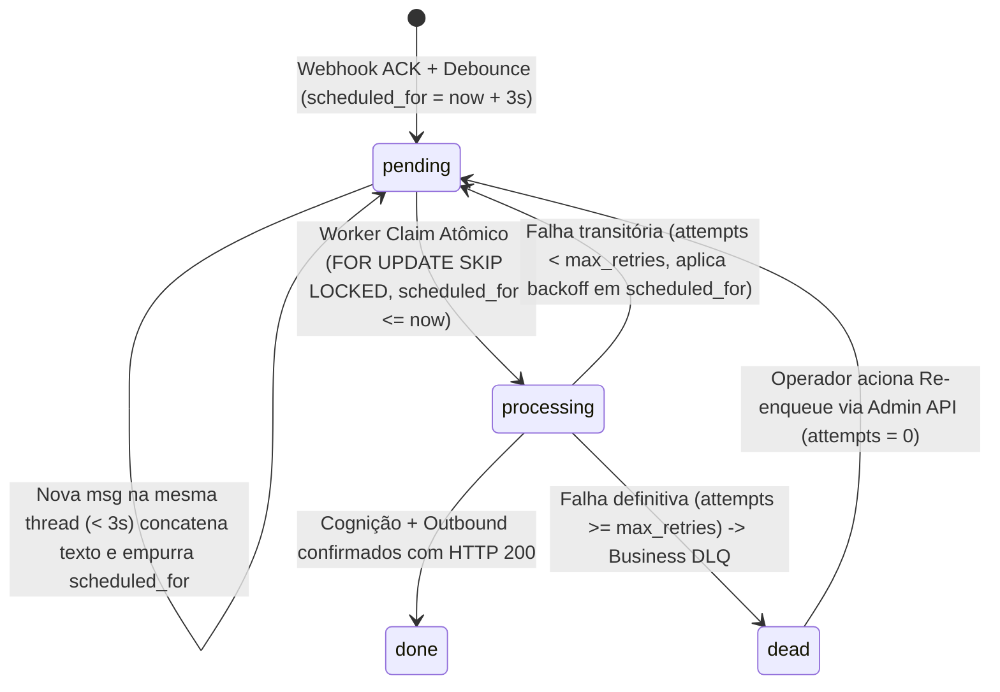
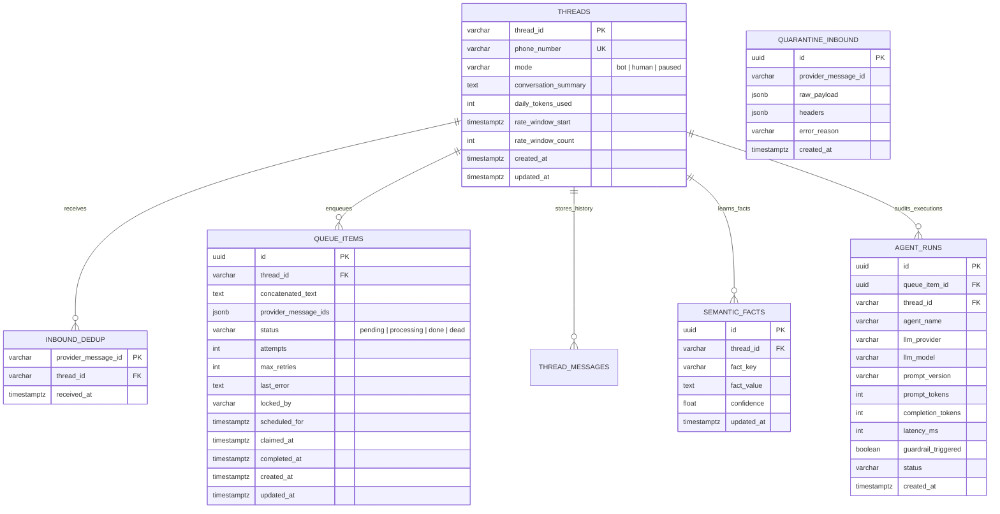

# Phase 1: Data Model & Database Schema (`data-model.md`)

**Feature**: `001-whatsapp-harness-mvp`  
**Date**: 2026-10-19  
**Spec**: [spec.md](./spec.md)

Este documento detalha os **Value Objects**, **Entidades de Domínio**, **Máquinas de Estado** e o **Schema Relacional/Vetorial no PostgreSQL 16 (`pgvector`)**.

---

## 1. Value Objects & Enums de Domínio (`src/harness/domain/`)

| Nome | Tipo Python | Regras de Validação e Imutabilidade |
| :--- | :--- | :--- |
| **`PhoneNumber`** | `@dataclass(frozen=True)` | Somente dígitos E.164 (ex.: `5511999998888`), entre 10 e 15 dígitos. |
| **`ThreadId`** | `@dataclass(frozen=True)` | Identificador determinístico derivado do `PhoneNumber` (ex.: `wa:5511999998888`). |
| **`QueueStatus`** | `StrEnum` | `PENDING = "pending"`, `PROCESSING = "processing"`, `DONE = "done"`, `DEAD = "dead"`. |
| **`ThreadMode`** | `StrEnum` | `BOT = "bot"`, `HUMAN = "human"`, `PAUSED = "paused"`. |
| **`MediaType`** | `StrEnum` | `TEXT = "text"`, `AUDIO = "audio"`, `IMAGE = "image"`, `UNSUPPORTED = "unsupported"`. |
| **`NormalizedTextMessage`** | `BaseModel (frozen=True)` | Contrato imutável que entra na fila: `thread_id`, `provider_message_id`, `sender_phone`, `text_content`, `original_media_type`, `received_at`. |

---

## 2. Máquina de Estados da Fila (`queue_items`)



---

## 3. Diagrama Entidade-Relacionamento (ERD)



---

## 4. Schema DDL Oficial (PostgreSQL 16 + `pgvector`)

Arquivo de migração inicial (`migrations/001_initial_schema.sql`):

```sql
-- Habilita extensões para UUID e Busca Vetorial (RAG)
CREATE EXTENSION IF NOT EXISTS "pgcrypto";
CREATE EXTENSION IF NOT EXISTS "vector";

-- 1. Tabela de Threads (Estado da Conversa, Rate Limit, Orçamento e Handoff)
CREATE TABLE IF NOT EXISTS threads (
    thread_id VARCHAR(64) PRIMARY KEY,
    phone_number VARCHAR(20) NOT NULL UNIQUE,
    mode VARCHAR(16) NOT NULL DEFAULT 'bot' CHECK (mode IN ('bot', 'human', 'paused')),
    conversation_summary TEXT NOT NULL DEFAULT '',
    daily_tokens_used INTEGER NOT NULL DEFAULT 0,
    daily_tokens_reset_at TIMESTAMPTZ NOT NULL DEFAULT NOW(),
    rate_window_start TIMESTAMPTZ NOT NULL DEFAULT NOW(),
    rate_window_count INTEGER NOT NULL DEFAULT 0,
    created_at TIMESTAMPTZ NOT NULL DEFAULT NOW(),
    updated_at TIMESTAMPTZ NOT NULL DEFAULT NOW()
);

-- 2. Tabela de Idempotência de Mensagens Recebidas (FR-005)
CREATE TABLE IF NOT EXISTS inbound_dedup (
    provider_message_id VARCHAR(128) PRIMARY KEY,
    thread_id VARCHAR(64) NOT NULL REFERENCES threads(thread_id) ON DELETE CASCADE,
    received_at TIMESTAMPTZ NOT NULL DEFAULT NOW()
);

-- 3. Tabela de Quarentena de Borda / Edge DLQ (FR-004)
CREATE TABLE IF NOT EXISTS quarantine_inbound (
    id UUID PRIMARY KEY DEFAULT gen_random_uuid(),
    provider_message_id VARCHAR(128),
    raw_payload JSONB NOT NULL,
    headers JSONB NOT NULL DEFAULT '{}'::jsonb,
    error_reason TEXT NOT NULL,
    created_at TIMESTAMPTZ NOT NULL DEFAULT NOW()
);

-- 4. Fila Transacional com Debounce Persistido e SKIP LOCKED (FR-006, FR-008, FR-009)
CREATE TABLE IF NOT EXISTS queue_items (
    id UUID PRIMARY KEY DEFAULT gen_random_uuid(),
    thread_id VARCHAR(64) NOT NULL REFERENCES threads(thread_id) ON DELETE CASCADE,
    concatenated_text TEXT NOT NULL,
    provider_message_ids JSONB NOT NULL DEFAULT '[]'::jsonb,
    status VARCHAR(16) NOT NULL DEFAULT 'pending' CHECK (status IN ('pending', 'processing', 'done', 'dead')),
    attempts INTEGER NOT NULL DEFAULT 0,
    max_retries INTEGER NOT NULL DEFAULT 3,
    last_error TEXT,
    locked_by VARCHAR(64),
    scheduled_for TIMESTAMPTZ NOT NULL DEFAULT NOW(),
    claimed_at TIMESTAMPTZ,
    completed_at TIMESTAMPTZ,
    created_at TIMESTAMPTZ NOT NULL DEFAULT NOW(),
    updated_at TIMESTAMPTZ NOT NULL DEFAULT NOW()
);

-- Índice parcial CRÍTICO para o Debounce: garante no máximo 1 item 'pending' por thread_id
CREATE UNIQUE INDEX IF NOT EXISTS idx_queue_unique_pending_thread
    ON queue_items (thread_id)
    WHERE status = 'pending';

-- Índice de alta performance para o Worker Claim (SKIP LOCKED)
CREATE INDEX IF NOT EXISTS idx_queue_claimable
    ON queue_items (scheduled_for ASC)
    WHERE status = 'pending';

-- 5. Histórico Operacional de Mensagens da Thread (Memória de Curto Prazo)
CREATE TABLE IF NOT EXISTS thread_messages (
    id UUID PRIMARY KEY DEFAULT gen_random_uuid(),
    thread_id VARCHAR(64) NOT NULL REFERENCES threads(thread_id) ON DELETE CASCADE,
    role VARCHAR(16) NOT NULL CHECK (role IN ('user', 'assistant', 'system')),
    content TEXT NOT NULL,
    is_summarized BOOLEAN NOT NULL DEFAULT FALSE,
    created_at TIMESTAMPTZ NOT NULL DEFAULT NOW()
);

CREATE INDEX IF NOT EXISTS idx_thread_messages_active
    ON thread_messages (thread_id, created_at ASC)
    WHERE is_summarized = FALSE;

-- 6. Memória Semântica do Cliente (FR-014)
CREATE TABLE IF NOT EXISTS semantic_facts (
    id UUID PRIMARY KEY DEFAULT gen_random_uuid(),
    thread_id VARCHAR(64) NOT NULL REFERENCES threads(thread_id) ON DELETE CASCADE,
    fact_key VARCHAR(64) NOT NULL,
    fact_value TEXT NOT NULL,
    confidence REAL NOT NULL DEFAULT 1.0,
    updated_at TIMESTAMPTZ NOT NULL DEFAULT NOW(),
    UNIQUE (thread_id, fact_key)
);

-- 7. Telemetria de Execuções / Runs e Auditoria (FR-017, FR-020)
CREATE TABLE IF NOT EXISTS agent_runs (
    id UUID PRIMARY KEY DEFAULT gen_random_uuid(),
    queue_item_id UUID REFERENCES queue_items(id) ON DELETE SET NULL,
    thread_id VARCHAR(64) NOT NULL REFERENCES threads(thread_id) ON DELETE CASCADE,
    agent_name VARCHAR(64) NOT NULL,
    llm_provider VARCHAR(32) NOT NULL,
    llm_model VARCHAR(64) NOT NULL,
    prompt_version VARCHAR(32) NOT NULL DEFAULT 'local-v1',
    prompt_tokens INTEGER NOT NULL DEFAULT 0,
    completion_tokens INTEGER NOT NULL DEFAULT 0,
    latency_ms INTEGER NOT NULL DEFAULT 0,
    guardrail_triggered BOOLEAN NOT NULL DEFAULT FALSE,
    guardrail_reason TEXT,
    status VARCHAR(16) NOT NULL CHECK (status IN ('success', 'blocked', 'failed')),
    created_at TIMESTAMPTZ NOT NULL DEFAULT NOW()
);
```
*(Nota: As tabelas vetoriais de RAG são gerenciadas automaticamente pelo `langchain-postgres` (`PGVector`) na coleção configurada em `harness.yaml`, utilizando a extensão `vector` habilitada acima).*

