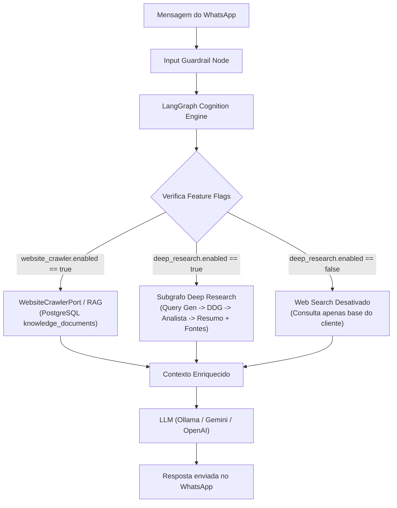

# Feature Specification: Ingestão de Sites Web & Deep Research Opcional (002-web-knowledge-and-deep-research)

> **Spec-Driven Development (SpecKit) — Fase 2 da WhatsApp AI Harness**  
> *Baseado em Clean Architecture, Domain-Driven Design (DDD), SOLID e Ports & Adapters (`typing.Protocol`).*

---

## 🎯 Visão Geral do Produto

Esta especificação estende o motor de IA da **WhatsApp AI Harness** para permitir o consumo e atendimento com base em **fontes externas da Web de forma 100% agnóstica**:
1. **Ingestão Agnóstica de Sites Institucionais / Lojas (`website_crawler`):** Rastreamento e ingestão semântica de qualquer site de cliente (e-commerce, clínica, escritório de advocacia, faculdade, cardápios ou páginas de serviços), utilizando a **Mawwal Arábia Brasil (`https://mawwal.com.br`)** como primeiro caso piloto validador.
2. **Deep Research na Web com 4 Estágios (`deep_research`):** Pipeline autônomo de pesquisa profunda na internet aberta via **DuckDuckGo Search** com:
   * **Planejador / Gerador de Queries:** Transforma dúvidas em buscas técnicas cirúrgicas.
   * **Buscador Web:** Coleta resultados em tempo real com timeout estrito.
   * **Analista de Resultados:** Filtra ruídos, avalia relevância e sintetiza fatos.
   * **Redator / Resumo com Fontes:** Gera resposta concisa para WhatsApp citando fontes/links.
3. **Controle Total via Feature Flags:** O administrador pode ligar ou desligar independentemente tanto o crawler de site quanto a pesquisa profunda através de `configs/harness.yaml` ou variáveis de ambiente no `.env`.

---

## 🧩 Arquitetura Agnóstica (Ports & Adapters)



---

## ⚙️ Configuração Operacional (`configs/harness.yaml`)

```yaml
# ==============================================================================
# Ingestão de Site do Cliente & Deep Research (Spec 002)
# ==============================================================================

website_crawler:
  enabled: true                        # Ativa a consulta à base do site do cliente
  provider: "http_crawler"             # "http_crawler" | "sitemap" | "api"
  target_url: "https://mawwal.com.br"  # URL base do site do cliente (qualquer site)
  sync_cron: "0 3 * * *"              # Agendamento de re-indexação (diário às 03:00)
  max_pages: 50                        # Limite de páginas por varredura
  chunk_size: 800                      # Tamanho do chunk para a base vetorial
  chunk_overlap: 100

deep_research:
  enabled: false                       # 👈 Chave Liga/Desliga da Pesquisa Profunda na Web
  provider: "duckduckgo"               # "duckduckgo" | "tavily"
  include_sources: true                # Cita as fontes ao final da resposta
  max_results: 3                       # Limite de links consultados por turno
  timeout_seconds: 5.0                 # Timeout estrito para preservar a latência do WhatsApp
```

---

## 👥 Histórias de Usuário & Critérios de Aceite (Gherkin)

### User Story 1 (P1): Ingestão e Consulta ao Site do Cliente via `scripts/crawl_website.py`
> **Como** dono de um negócio ou gestor comercial (ex.: Mawwal Arábia Brasil, clínica, universidade),  
> **Quero** que o assistente leia as páginas, produtos, preços e serviços do meu site através do script `scripts/crawl_website.py`,  
> **Para que** os clientes recebam informações precisas e atualizadas sem necessidade de atendimento humano.

#### Cenário 1.1: Cliente pergunta sobre informações existentes no site do cliente
* **Given** que `website_crawler.enabled` está configurado como `true` com o site `https://mawwal.com.br` indexado,
* **When** o usuário envia *"Qual o valor do perfume Malek e quais as notas olfativas?"*,
* **Then** o agente consulta a base vetorial do site,
* **And** responde citando as notas olfativas e o preço oficial cadastrado no site.

#### Cenário 1.2: Ingestão de site desativada via configuração
* **Given** que `website_crawler.enabled` está configurado como `false`,
* **When** o usuário envia qualquer pergunta sobre o site,
* **Then** o motor LangGraph não aciona o contexto do site, utilizando apenas a base local existente.

---

### User Story 2 (P2): Controle Dinâmico da Pesquisa Profunda na Web com Analista e Fontes
> **Como** administrador da plataforma,  
> **Quero** ligar ou desligar a ferramenta de pesquisa profunda na internet aberta (`deep_research.enabled`),  
> **Para que** quando ativada, ela execute um pipeline com analista de relevância, resumo e citação de fontes, e quando desativada não faça requisições externas.

#### Cenário 2.1: Pesquisa profunda desativada (`deep_research.enabled = false`)
* **Given** que `deep_research.enabled` está configurado como `false`,
* **When** o cliente pergunta um tema conceitual externo que não consta no site,
* **Then** o agente **não** dispara nenhuma requisição HTTP externa para o DuckDuckGo,
* **And** responde educadamente com base no seu conhecimento prévio de sistema ou orienta o cliente a focar no site oficial.

#### Cenário 2.2: Pesquisa profunda ativada (`deep_research.enabled = true`)
* **Given** que `deep_research.enabled` está configurado como `true`,
* **When** o cliente faz uma pergunta que exige pesquisa web aberta,
* **Then** o agente gera queries cirúrgicas, consulta o DuckDuckGo, passa pelo analista de relevância e gera um resumo objetivo com links de fontes citadas.

---

### User Story 3 (P3): Rastreamento e Ingestão Automatizada de Qualquer Site via CLI
> **Como** desenvolvedor ou operador do sistema,  
> **Quero** rodar o comando CLI `uv run python scripts/crawl_website.py --url https://qualquer-site.com.br`,  
> **Para que** o sistema varra as páginas do site do cliente, particione em chunks semânticos e armazene na tabela `knowledge_documents` do PostgreSQL.
