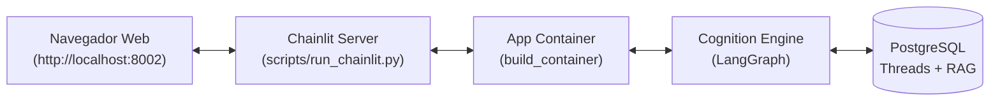

# Plano Arquitetural: Interface Web com Chainlit (003-chainlit-web-ui)

> **SpecKit — Technical Design & Architecture**

---

## 🏛️ 1. Mapeamento de Camadas

| Componente | Responsabilidade |
| :--- | :--- |
| `scripts/run_chainlit.py` | Entrypoint do servidor Chainlit (`@cl.on_chat_start`, `@cl.on_message`). |
| `.chainlit/config.toml` | Customizações visuais (tema escuro/claro, nome do assistente). |
| `build_container(cfg)` | Wiring oficial da aplicação, injetando o motor LangGraph e o repositório de threads. |

---

## 📐 2. Ciclo de Vida da Sessão no Chainlit

1. **`@cl.on_chat_start`:**
   * Inicializa o container global se necessário.
   * Gera um `ThreadId("web_{user_session_id}")`.
   * Envia uma mensagem inicial de boas-vindas ao usuário.
2. **`@cl.on_message`:**
   * Recupera o `ThreadId` da sessão.
   * Cria um `cl.Message(content="")`.
   * Executa `container.cognition_engine.generate_reply(thread_id, message.content)`.
   * Exibe a resposta final e atualiza a interface.

